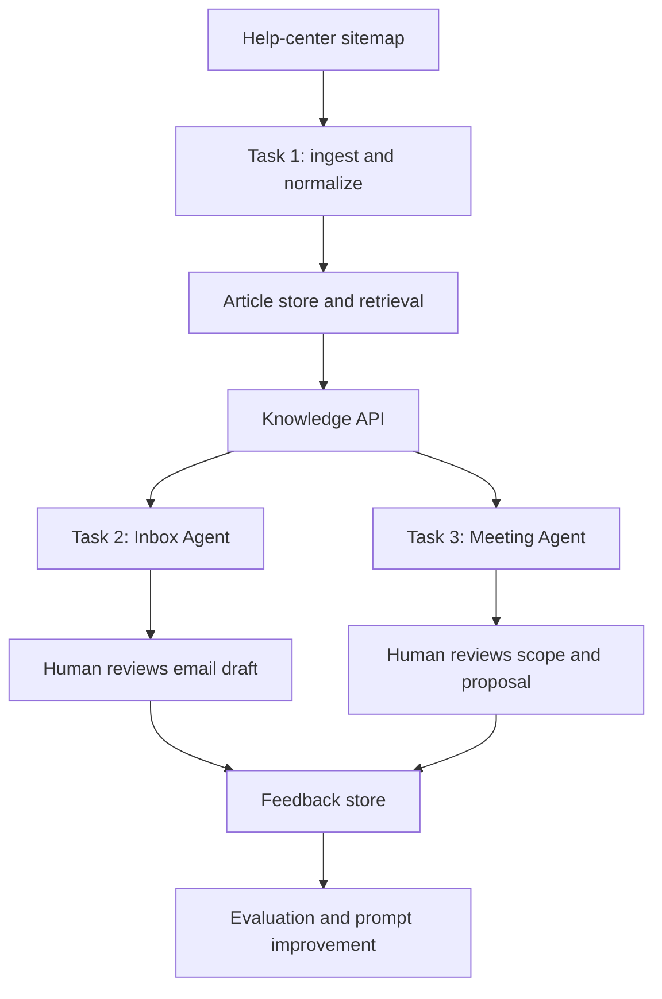

# Design Notes — AI Tech Consultant

## Problem
Small software/service businesses spend significant time finding product facts, replying to email, and converting vague meetings into estimates. The system connects these workflows while keeping a human responsible for customer-facing commitments.

## Architecture

## Important design choices
- Task 1 owns the knowledge and source citations. Other tasks call its API rather than copying retrieval logic.
- Claude is the central language model. A model name is configurable because model availability and pricing change.
- All externally visible content is a draft until a human approves it.
- A question with no supporting source should produce an explicit abstention, not an invented answer.
- Feedback is logged as examples for future evaluation; this MVP does **not** silently train or modify model weights.
- The first retrieval implementation uses transparent lexical matching. This makes local development easy and testable. A production version should compare lexical retrieval with embeddings/vector search on a labeled dataset.
- Sitemap refresh is an initial URL comparison hook. Full polite scraping, retries, content hashing, image download/OCR/vision, and deletion reconciliation remain production hardening tasks.

## Risks and controls
| Risk | Control |
|---|---|
| Outdated or removed article | Store source URL and last-seen time; refresh and remove stale content from retrieval |
| Hallucinated policy | Answer only from retrieved context; cite URLs; abstain when no useful match |
| Prompt injection in scraped text/email | Treat source text as untrusted data, not instructions |
| Email accidentally sent | No send integration in MVP; approval endpoint only |
| Scope estimate mistaken for commitment | Mark estimates as assumptions and require senior/human approval |
| API outage or rate limit | Return controlled error; add retries with backoff and bounded timeouts before production |
| PII in logs | Minimize email data and redact personal information before production logging |

## What is not production-ready
- The sample knowledge base is only a tiny fixture.
- The sitemap refresh route does not yet crawl every article page and interpret all media.
- Image understanding/OCR and multimodal indexing are not fully implemented.
- Feedback is recorded but not automatically promoted into prompts without evaluation.
- Cost estimates must use the actual account/model pricing and API usage returned at runtime.
- No email provider, calendar, CRM, or document-signing integration is connected.
